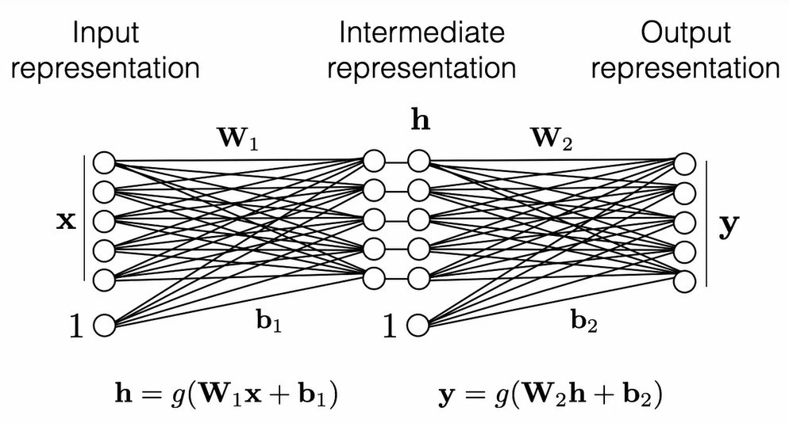
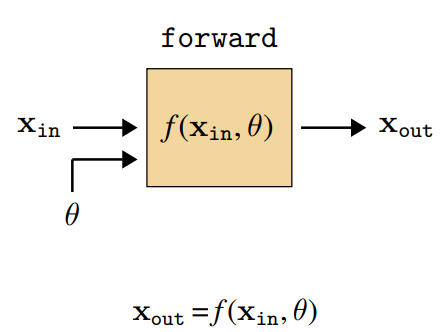
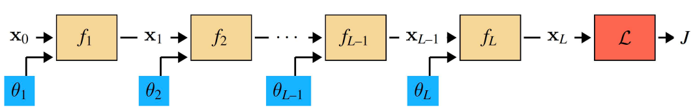
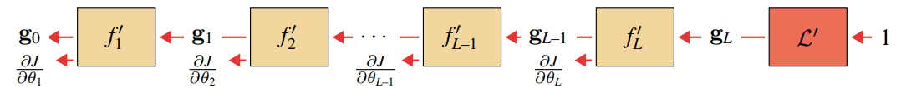
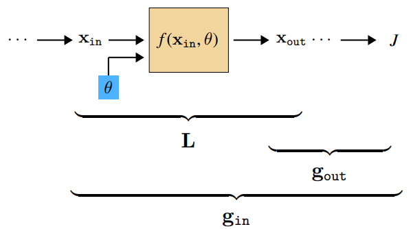
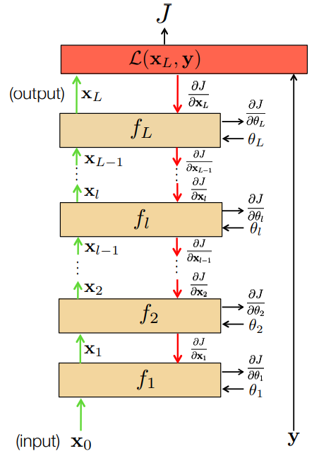

# Deep Learning笔记
---
本笔记基于MIT 6.7960 深度学习课程，具体参考[课程网站](https://ocw.mit.edu/courses/6-7960-deep-learning-fall-2024/)。未经允许，不得转载。

## 一、导论
### 1. 深度学习组成
1. **神经网络 (Neural nets)**：一类机器学习架构，通过堆叠线性变换层，并在其间穿插逐点非线性操作实现。
2. **微分编程 (Differential programming)**：一种编程范式，通过参数化程序中的某些部分，并利用基于梯度的优化方法调整这些参数，从而优化程序性能。

### 2. 梯度下降 (Gradient descent)
$$\theta^* = \arg\min_{\theta} \underbrace{\sum_{i=1}^{N} \mathcal{L}(f_\theta(\mathbf{x}^{(i)}), \mathbf{y}^{(i)})}_{J(\theta)}$$

梯度下降的一次迭代本质为如下过程：
$$\theta^{t+1}=\theta^t-\eta_t \left. \frac{\partial J(\theta)}{\partial \theta} \right|_{\theta = \theta^t}$$
其中 $\eta_t$ 称为学习率 (learning rate)。

### 3. 神经网络中的计算
神经网络首先进行线性组合，计算方式如下：
$$z_j=\sum_i w_{ij}x_i+b_j$$
其中，$w_{ij}$ 为权重，而 $b_j$ 为偏置项。

此外，也可以用向量化表示进行书写。
$$z_j = \mathbf{x}^T \mathbf{w}_j + b_j$$
其中，$\mathbf{w}_j$ 为向量化权重，$b_j$ 表示偏置。

模型参数表示如下：
$$\theta = \{\mathbf{W}, \mathbf{b}\}$$

神经网络还需要通过某种非线性函数来映射输出结果，非线性函数可以表示为 $g(z)$，通常是一种**逐点非线性函数**。

以下是一些常见的非线性函数：
1. 双曲正切函数
$$g(z)=\tanh(z)=\frac{e^z-e^{-z}}{e^z+e^{-z}}$$

2. Sigmoid函数
$$g(z)=\frac{1}{1+e^{-z}}$$

3. **修正线性单元 (ReLU)**
$$g(z)=\max(0,z)$$

其优势在于实现效率高，导数为阶跃函数。缺陷在于，如果输入值处于强烈负值区域，神经元进入“死亡”状态，梯度消失。

### 4. 层堆叠

理论上，对于两层及以上堆叠，在引入非线性函数情况下，可以表示任意函数。

### 5. Softmax 函数与交叉熵损失函数
Softmax 函数将模型输出的任意实数（得分），转化为符合概率分布的数值（概率）。其函数表示为：
$$\hat{y}_k = \text{Softmax}(z_k) = \frac{e^{z_k}}{\sum_{j=1}^{K} e^{z_j}}$$

交叉熵损失函数用以衡量正式标签分布与模型预测分布之间的差异，其函数表示为：
$$H(\mathbf{y}, \mathbf{\hat{y}}) = -\sum_{k=1}^{K} y_k \log \hat{y}_k$$

## 二、神经网络训练
### 1. 梯度下降
$$\theta^* = \arg\min_{\theta} \underbrace{\sum_{i=1}^{N} \mathcal{L}(f_\theta(\mathbf{x}^{(i)}), \mathbf{y}^{(i)})}_{J(\theta)}$$

单次梯度下降迭代为：
$$\theta^{k+1}\leftarrow\theta^k-\eta\nabla_\theta J(\theta^k)$$

$\eta$ 为学习率，决定沿着梯度方向前进的步长。

### 2. 随机梯度下降 (Stochastic Gradient Descent)
SGD 中，对数据集的某个子集计算梯度，可以合理近似替代对整个数据集计算梯度。将这一子集称为批次 (batch)。

- 如果批次大小为1，则意味着每看到数据集中一个样本，则更新一次参数。
- 如果批次大小为 N，与完整数据集大小相同，则变为梯度下降。

与所有示例的平均值相比，即标准梯度下降，SGD 梯度方向存在噪声。

SGD 同时具有如下优势：
- 速度更快：即使使用小样本，也能很好地逼近总体梯度。
- 隐式正则化：随机噪声实际上起到了一种隐式正则化作用，帮助模型跳出局部最小值，更有可能找到接近全局最优解的路径。

SGD 同样也会导致方差较大，且参数更新不稳定。

### 3. 动量 (Momentum)
通过引入动量，让梯度更新倾向于延续之前更新的方向：
$$\theta^{t+1}\leftarrow\theta^t-\eta\nabla f(\theta^k)-\alpha m^t$$

$\alpha$ 为动量强度，是超参数。

### 4. 进化策略
进化策略具有类似梯度的特性，能够在参数空间中寻找局部损失最小化的方向。

进化策略在现有参数值周围进行微小扰动采样，然后沿能够降低损失值的扰动方向移动。
$$\begin{aligned}
\epsilon_i &\sim \mathcal{N}(\mathbf{0}, \mathbf{I}) \\
s_i &= J(\theta + \sigma\epsilon_i)
\end{aligned}
\qquad
\theta^{k+1} \leftarrow \theta^k - \eta \frac{1}{\sigma M} \sum_{i=1}^M s_i\epsilon_i$$

### 5. 梯度裁剪
梯度裁剪主要应对损失函数中可能出现的“尖峰”或“陡峭”区域。

如果梯度值超过某个设定的较大阈值，则只需将其按比例约回该阈值范围内。
$$\begin{aligned}
&\mathbf{v} = \nabla_\theta J(\theta^k) \\
&\theta^{k+1} \leftarrow \theta^k - \eta [\operatorname{clip}(v_1, -m, m), \dots, \operatorname{clip}(v_M, -m, m)]^\top
\end{aligned}$$

### 6. 前向传播与反向传播
#### (1) 计算图
计算图是一个由不同函数变换（节点）构成的图，并且当这些节点串联起来时，便能执行某些有用的计算。

深度学习主要处理的是有向无环图 (DAGs)，且每一个节点都是可微的。

#### (2) 前向传播

多层前向传播可以表示一个多层感知机 (MLP)。

#### (3) 反向传播
依据链式法则，可以将参数偏导数分解为：
$$\frac{\partial J}{\partial \theta_i} = \frac{\partial J}{\partial \mathbf{x}_L} \frac{\partial \mathbf{x}_L}{\partial \mathbf{x}_{L-1}} \cdots \frac{\partial \mathbf{x}_{i+1}}{\partial \mathbf{x}_i}  \frac{\partial \mathbf{x}_i}{\partial \theta_i}$$

由于$\frac{\partial \mathbf{x}_i}{\partial\theta_i}$项前的系数可以共享，所以只需要计算其值一次即可。

反向传播需要跟踪两类偏导数数组：
- **L**：层输出相对于层输入的梯度，为一个矩阵。

$$\begin{aligned}
\mathbf{L} &\triangleq \frac{\partial \mathbf{x}_{\text{out}}}{\partial [\mathbf{x}_{\text{in}}, \theta]} \\
\mathbf{L}^{\mathbf{x}} &\triangleq \frac{\partial \mathbf{x}_{\text{out}}}{\partial \mathbf{x}_{\text{in}}} \\
\mathbf{L}^{\theta} &\triangleq \frac{\partial \mathbf{x}_{\text{out}}}{\partial \theta}
\end{aligned}
$$

- **g**：损失函数关于激活值的梯度，为行向量。

$$\begin{aligned}
\mathbf{g} &\triangleq \frac{\partial J}{\partial \mathbf{x}} \\
\mathbf{g}_{\text{out}} &\triangleq \frac{\partial J}{\partial \mathbf{x}_{\text{out}}} \\
\mathbf{g}_{\text{in}} &\triangleq \frac{\partial J}{\partial \mathbf{x}_{\text{in}}}
\end{aligned}
$$

在已知 **L** 与 **g** 情况下，容易完成对于单层参数的更新：
$$\frac{\partial J}{\partial\theta}=\frac{\partial J}{\partial\mathbf{x}_{out}}\frac{\partial\mathbf{x}_{out}}{\partial\theta}=\mathbf{g}_{out}\mathbf{L}^{\theta}$$

$$\theta^{i+1}\leftarrow\theta^i-\eta\left(\frac{\partial J}{\partial\theta}\right)^{\text{T}}$$

其中，对于 $\mathbf{L}$ 与 $\mathbf{g}$，其计算方式如下：
$$\mathbf{L}=f'(\mathbf{x}_{in},\theta)$$

$$\mathbf{g}_{in}=\mathbf{g}_{out}\mathbf{L}^{\mathbf{x}}$$

#### (4) 完整算法流程
完整算法流程为，先进行前向传播，再进行反向传播，更新参数，并重复这一过程。

### 7. MLP 反向传播
#### (1) 线性层
线性层中，$\mathbf{x}_{out}=\mathbf{W}\mathbf{x}_{in}$，因此有：
$$\mathbf{g}_{in}=\mathbf{g}_{out}\frac{\partial\mathbf{x}_{out}}{\partial\mathbf{x}_{in}}=\mathbf{g}_{out}\cdot\mathbf{W}$$

